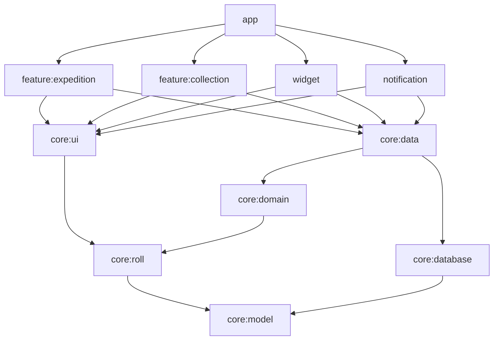

# Seirei Ruins（PoC）

Android アプリ「Seirei Ruins」のプロジェクト `additive-game`。

Android のホーム画面 Widget に住みつく精霊を、ランタン方式の放置探索で育て、目を覚ました住人（★・性格・色の3軸）を集めて厳選する PoC。
常駐表示は Widget・ステータスバーのチップ（Live Updates）・通知シェードの三層。サーバーなし、完全ローカル。

- **実装者（AI エージェント）向けの規約：[`AGENTS.md`](AGENTS.md)**
- 設計書：[`docs/`](docs/)（00 コアループ／01 状態機械／02 ロールエンジン／03 データ層／04 プレゼンテーション層／05 アプリUI）
- 決定記録：[`docs/decisions.md`](docs/decisions.md)
- タスク（GitHub issue と対応表）：[`planning/`](planning/README.md)
- 状態機械の形式仕様（TLA+）：[`formal/`](formal/README.md)

## 構成



`core:model`・`core:domain`・`core:roll` は純 Kotlin。エンジンと状態導出はエミュレータなしの `./gradlew test` で検証できる。

| 項目 | 値 |
|---|---|
| minSdk / targetSdk | 34 / 36（ADR D-005） |
| フレーバ | `standard`（探索120分）・`demo`（探索3分、`dev.seirei.ruins.demo`） |
| DI | 手動（`AppContainer`。ADR D-006） |
| 永続化 | Room 単一DB（設計書03） |

## はじめに

```bash
./gradlew check                    # まずこれが通る状態にする（issue E0-01）
python3 tools/roll_sim.py          # 確率設計の確認
tools/tlc.sh                       # 状態機械の再検査
```

## 現在の状態（2026-10-11）

骨組みと凍結部分（`derivePhase`・`Rng`）・仮画像57点・GitHub issue 62件まで。
E0-01（#23）のローカル検証では `./gradlew check`、standard/demo APK assemble、TLA+、参照スクリプトが成功。後続の着手はE0-01がCIを通過して閉じた後。
