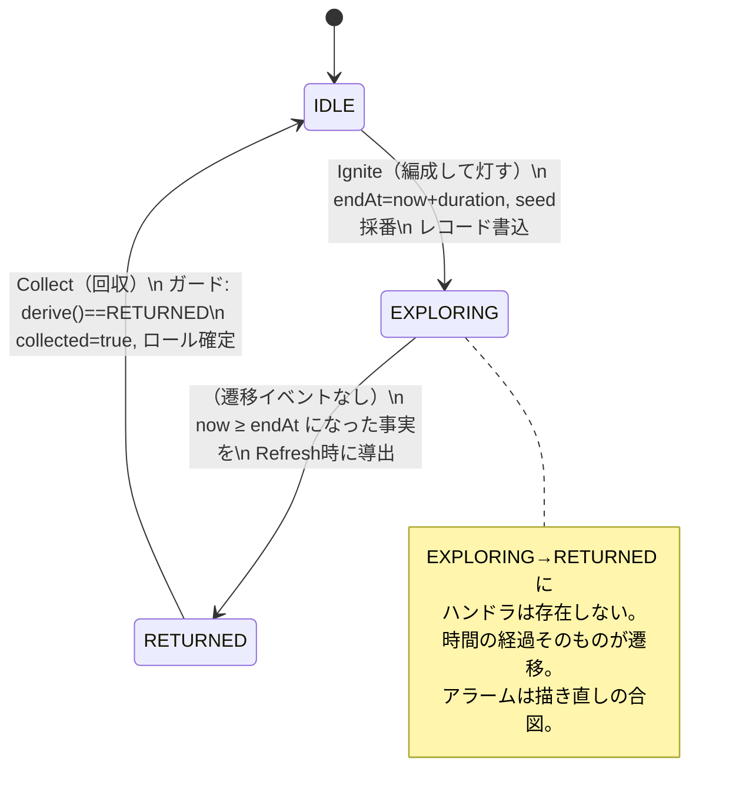

# 設計書 01：探索セッション状態機械

『遺跡に住みつく精霊』PoC — `:core:model` / `:core:domain` 中核設計（v0.5）

改訂履歴：
v0.5 — `ContextSnapshot` に点火時の時間帯 `timeBand` と天気の中立値 `UNKNOWN` を追加（設計書02 v0.4の修正値モデル）。`Ignite` は天気を保存値から読むだけでネットワークに触れないことを明記（取得・保存は設計書03 §2.1）。状態機械・原則・TLA+検証結果は無変更。
v0.4 — 主人公概念の廃止に伴う追記（隊長＝探索の主役、チップアイコン＝ランタン、初期付与1体）。留守番役に手押し車を追加。状態機械・原則・TLA+検証結果は無変更。
v0.3 — セッション保存先をDataStore→Room単一行テーブルへ変更（設計書03の原子性要件を反映）。`ContextSnapshot` フィールド追加（設計書02 原則E）。
v0.2 — §6を全面改訂（Widget留守番ルール／隊長トラッカー＝Live Updates公式UXプラクティスへの対応／チップとシェードの役割分担）、§10に更新間隔等を追加

対応モジュール：`:core:model`（純Kotlin）、`:core:domain`（純Kotlin）、`:core:database` / `:core:data`（Room・設計書03）
形式検証：TLA+ / TLC によるモデル検査済み（§8、付属 `ExplorationSession.tla`）

---

## 1. 目的とスコープ

コアループ仕様書の「ランタン方式（決定論的リソース）一本化」を、実装可能な状態機械として確定する。本書が定義するのは以下の3点。

1. 永続化する状態の最小集合と、そこからの**フェーズ導出関数**
2. 状態を変更できる**イベントハンドラとそのガード条件**
3. 異常系（プロセスキル・アラーム遅延/欠落・時計変更・連打）の吸収方法

バトルの中身・ロールテーブルの数値は設計書02（ロールエンジン）に委ねる。本書ではロールエンジンを「シードを入力に取る純関数」としてのみ扱う。

---

## 2. 設計原則（4箇条・TLC検証済み）

本設計のすべての判断は次の4原則から導かれる。§8のモデル検査により、この4原則を守る限り異常系が安全であること、原則Dを破ると事故が起きることを機械的に確認済み。

- **原則A：永続化するのは不変の事実のみ。フェーズは保存しない**
  保存するのは「いつ灯したか・いつ消えるか・どのシードか・誰を連れて行ったか・回収済みか」。`EXPLORING` のような状態名をDBに書くと、時刻とのズレ（＝バグの温床）が生まれる。
- **原則B：フェーズは純関数で毎回導出する（pull型）**
  `phase = derive(record, now)`。Widget・チップ・通知・アプリ本体のどこから見ても、同じレコードと同じ時刻からは同じフェーズが出る。三層サーフェスの表示不整合が構造的に起きない。
- **原則C：アラーム/タイマーは状態を変更しない。表示再導出のトリガーに過ぎない**
  AlarmManagerの発火は `Refresh`（再導出して描き直すだけ）にマップする。これにより**遅延・欠落・重複発火がすべて無害**になる。Dozeでアラームが2時間遅れても、次にホーム画面を見た瞬間に正しい表示になる。
- **原則D：ハンドラは描画済みUIを信用しない。永続状態から再導出してガードする**
  回収ボタンのタップ時、通知やWidgetが「帰還」を表示していたことは根拠にならない。ハンドラ内で改めて `derive(record, now)` を評価し、`RETURNED` のときだけ処理する。

---

## 3. 永続モデル（単一の真実）

Roomの単一行テーブル `session` として保存する（v0.3改訂：当初DataStoreとしていたが、回収時の「住人挿入＋魔力加算＋回収済み化」を1トランザクションで原子化するため、コレクション・魔力と同一DBに一本化。設計書03 §2）。

```kotlin
// :core:model — 純Kotlin、Android非依存
data class ExplorationSession(
    val id: Long,                  // 単調増加。回収の冪等性キー（レシートPKの参照元）
    val startedAt: Instant,        // 点火時刻（壁時計）
    val endAt: Instant,            // 点火時に確定（ランタン方式）
    val seed: Long,                // ロール・バトルログの全てを決めるシード
    val partyIds: List<Long>,      // 編成（住人個体ID）。[0]が隊長
    val snapshot: ContextSnapshot, // 点火時の外部世界の固定値（設計書02 原則E）
    val collected: Boolean,        // 回収済みフラグ
)

data class ContextSnapshot(
    val date: LocalDate,        // 曜日・曜日祭壇・月齢の導出元（端末タイムゾーンのローカル日付）
    val timeBand: TimeBand,     // v0.5追加：点火時刻の時間帯（DAY / EVENING / NIGHT）
    val weather: WeatherKind,   // 点火時点の保存値（固定地域の「今日の天気」）。取得できていなければ UNKNOWN
)
// WeatherKind / TimeBand の定義と境界時刻は設計書02 §2。いずれも不変の事実が増えるだけで、遷移・不変条件に影響しない

// DB上は単一行（最新セッションのみ）。行なし = セッションなし
```

**フェーズは導出値であり、この型はどこにも保存されない：**

```kotlin
enum class SessionPhase { IDLE, EXPLORING, RETURNED }

fun derivePhase(s: ExplorationSession?, now: Instant): SessionPhase = when {
    s == null || s.collected -> SessionPhase.IDLE
    now < s.endAt            -> SessionPhase.EXPLORING
    else                     -> SessionPhase.RETURNED
}
```

### 時計の選択：壁時計を採用（判断とリスク受容）

`elapsedRealtime()` は再起動で巻き戻るため数時間スケールのセッションに使えない。壁時計（`currentTimeMillis`）を採用する。ユーザーが時刻を進めると早回し（チート）が可能だが、**完全ローカル・PoC・被害者のいないゲーム**であり受容する。§8のとおり、時計を操作されても「二重回収」「不正な状態遷移」は起きないことを検証済み。防止したいのは事故であってチートではない。

---

## 4. 状態遷移図



矢印が3本しかないことが本設計の要点。**状態を変更できる操作は `Ignite` と `Collect` の2つだけ**で、他のすべて（アラーム発火、アプリ起動、Widget更新、プロセスキルからの復帰）は `Refresh`＝再導出に合流する。

---

## 5. イベントハンドラ仕様

| ハンドラ | 発火元 | ガード（永続状態から評価） | 効果 |
|---|---|---|---|
| `Ignite(party)` | アプリ本体の編成画面 | `derive() == IDLE` | `ContextSnapshot` 取得・固定（日付＋時間帯＋天気。設計書02 原則E。天気は保存値を読むだけ） → 新レコード書込（`endAt = now + duration`、`seed` 採番） → AlarmManagerに `endAt` で1本セット → 三層へRefresh |
| `Collect()` | Widgetタップ / 通知タップ → アプリ | `derive() == RETURNED` | `seed` からロール一括計算（設計書02） → 単一Roomトランザクション：レシート挿入＋住人書込＋魔力加算＋`collected = true`（設計書03 §4.1） → Refresh |
| `Refresh()` | アラーム発火 / `BOOT_COMPLETED` / Widget `onUpdate` / アプリ `onResume` / 通知更新Worker | なし（常に安全） | `derive(record, now)` を評価し三層を描き直すだけ。**書込なし** |

補足事項：

- **Igniteはネットワークに触れない**（v0.5）：天気は設計書03 §2.1の保存値（`app_settings` 行）を読むだけ。取得から6時間以内ならその値、それより古いか未設定なら `UNKNOWN`（中立）で固定する。これにより「灯す」は常に即時に完了し、オフラインでも灯せる。天気の取得は編成画面表示時などに非同期で行い、Igniteの成否に関与させない
- **ガード不成立時は黙って何もしない**（Refreshだけ行う）。連打・古い通知からのタップ・レース時に、例外でもエラーToastでもなく「正しい現在表示」を返すのが正解。
- **Collectの冪等性**：全書込は単一Roomトランザクションで原子化し、`collection_receipt` テーブルの `sessionId` PKで二重回収をDB制約でも防ぐ（原則Dのガードとの二重防御。設計書03 §4.1が実体）。
- **再起動対応**：AlarmManagerは再起動で消えるため、`BOOT_COMPLETED` レシーバで「未回収セッションがあればアラーム再セット＋Refresh」を行う。仮にレシーバが動かなくても、原則B/Cにより次の画面表示時に正しい状態が出る（アラームは体験の質を上げる装置であり、正しさの前提ではない）。

---

## 6. 三層サーフェス仕様（v0.2改訂）

三層はいずれも `SessionRepository.sessionFlow`（レコード）を購読し、各自 `derive()` して描く**読み取り専用ビュー**。サーフェス間の直接通信は禁止。

本節で導入する2つの表示概念：

- **隊長**：編成の1枠目の住人。通知シェードの `ProgressStyle` トラッカーアイコンとして表示される個体。編成順に意味を持たせ、厳選した自慢の個体を「連れて歩く姿」として見せる場所を作る。**固定の主人公は存在せず、隊長が探索の主役**（コアループ v2.1 §1）。編成が空のときのトラッカーはランタンアイコンにフォールバックする。
- **留守番組**：編成に入っていない住人。**Widgetには常に留守番組が残る**。編成メンバーの不在自体が「探索中」の視覚表現を兼ねる。

### 6.1 フェーズ × サーフェス対応表

| フェーズ | Widget（Glance） | ステータスバーチップ | 通知シェード / ロック画面 |
|---|---|---|---|
| IDLE | 全住人の待機風景（編成メンバー含む）。タップ→アプリ（編成へ） | 非表示 | 非表示 |
| EXPLORING | **留守番組のみ**の風景＋探索演出（袋が膨らむ表示専用差分）。編成メンバーは不在。タップ→アプリ | モノクロ**ランタン**シルエット（smallIcon）＋ `setWhen(endAt)` の残り時間カウントダウン（OS描画委譲） | `ProgressStyle`：start＝遺跡入口、end＝ホーム、**トラッカー＝隊長のカラーアイコン**がゲージ上を進む（A16未満は通常常駐通知） |
| RETURNED | 編成メンバー帰宅＋喜び姿勢へ切替。タップ→回収画面 | 「帰還」表示 | 「精霊が帰ってきた」通知。タップ→回収画面 |

### 6.2 Widgetの表示導出ルール

- 留守番組は全フェーズで常時表示。住人が増えるほどEXPLORING中も画面が賑わう（外側ループ「遺跡の成長」がそのまま常駐表示の質に還元される）。
- 序盤の住人0〜1体期は留守番役アセット（灯ったランタン・膨らむ発掘袋・覚醒前の壺・発掘用の手押し車）を置き、画面が空になる穴を塞ぐ。初回起動時にモチーフ#1を1体付与する（設計書03 §4.6）ため、住人0体は初回起動直後のみ。
- 「何かしている様子」は**更新契機（Refresh）ごとの静止画差し替えが上限**。Glance/RemoteViewsは常時フレームアニメ不可であり、「リアルタイム描画はしない」の確定事項とも整合。
- ポーズ・立ち位置のバリエーションも原則Bを適用し純関数で導出する：`variation = f(record, nowを粗い粒度に丸めた値, 住人id)`。追加の永続状態ゼロで「目を離すと動いている」を実現する。

### 6.3 Live Updatesの層別詳細

以下の制約・プラクティスは公式ドキュメント（developer.android.com/develop/ui/compose/notifications/live-update、2026-08-20更新版）で確認済み。チップとシェードでは表現能力が異なるため、役割を分担する。

- **チップ**：smallIcon＋`setWhen` によるカウントダウンまたは `setShortCriticalText` のみ。カスタムRemoteViewsは置けず、最大幅96dp、テキストは7文字未満なら全文表示。世界観表現は担わず「気配＋残り時間」に徹する（既存確定事項どおり）。
- **シェード（`ProgressStyle`）**：トラッカーアイコンで状態を可視化するのは公式のUXプラクティスであり、動的更新が可能。ここに隊長のカラーアイコンを置き、「隊長がゲージ上を歩いてホームへ帰ってくる」画を作る。
- **トラッカー位置はOSが自動進行させない**ため、位置更新は通知の再投稿で行う。再投稿は `Refresh`（書込なしの再描画）そのものであり原則Cに完全準拠、状態機械は無傷。更新間隔はバッテリーとのトレードオフで要確定（§10）。なお `setWhen` のカウントダウンはOS任せのため、仮に位置更新が止まっても残り時間表示は正確なまま。
- **promoted要件との整合**：ProgressStyleは対象スタイルに含まれ、ongoing・contentTitle必須・RemoteViews禁止・`POST_PROMOTED_NOTIFICATIONS` のマニフェスト宣言が条件。既存の技術確定事項と矛盾なし。「ユーザーが明示的に開始した、明確な始点と終点を持つ進行中の活動」という利用基準にも、点火→帰還の構造がそのまま該当する。

### 6.4 アート仕様書への波及（追記依頼）

隊長トラッカー用の小型カラーアイコン（既存スプライトの縮小流用を第一候補に検証）、`ProgressStyle` のstart/endアイコン（遺跡入口／ホーム）、序盤用の留守番役アセット（既存流用で可）。チップ用smallIconはモノクロ・アルファのみの制約があるため、**ランタンシルエット**の単色版（`ic_lantern_silhouette.png`）が別途必要。アプリアイコンもランタンとし、シンボルを統一する（アート発注仕様書 v0.3 §7・§8）。

カウントダウンは `endAt` を渡してOSに描画委譲するため、**EXPLORING中にアプリプロセスが生きている必要は一切ない**（トラッカー位置の更新のみ任意頻度のRefreshで行う）。

---

## 7. 異常系カタログ

各異常が「どの原則によって無害化されるか」を明記する。実装時のテスト観点一覧を兼ねる。

| # | 異常 | 何が起きるか | 吸収機構 |
|---|---|---|---|
| 1 | アラーム遅延（Doze等） | RETURNEDへの表示切替が遅れる | 原則B/C：次の任意のRefresh契機で正しく表示。状態は最初から正しい |
| 2 | アラーム欠落 | 同上 | 同上。`WorkManager` の保険的定期Refresh（15分级）を併用してもよいが必須ではない |
| 3 | アラーム重複発火 | Refreshが2回走る | 原則C：Refreshは冪等（書込なし） |
| 4 | プロセスキル / 再起動 | 揮発状態（描画・メモリ）消失 | 原則A：レコードはRoomに永続。BOOT_COMPLETEDでアラーム再セット |
| 5 | 回収ボタン連打 / 二重タップ | Collectが並行侵入 | 原則D＋トランザクション＋`id`冪等キー。2回目はガード不成立で無反応 |
| 6 | 古い通知からのタップ（回収済み後） | RETURNEDでないのにCollect要求 | 原則D：ガード不成立→Refreshのみ |
| 7 | 時計を進める | 探索の早回し（チート） | 受容（§3）。安全性は壊れない |
| 8 | 時計を戻す | RETURNED表示中に実フェーズがEXPLORINGへ回帰 | 原則D：Collectハンドラが再導出で弾く。**UI表示をガードに使うとここで事故る（§8反例）** |
| 9 | Widgetの再生成・複数配置 | 複数ビューが並存 | 原則B：全ビューが同一レコードから導出するため矛盾しない |
| 10 | 探索中のアプリアップデート | プロセス再生成 | #4と同じ。スキーマ変更はRoomマイグレーション（PoCでは破壊的移行を許容、設計書03 §6）で対応 |

---

## 8. TLA+ による形式検証

上記の設計原則を TLA+ で形式化し、TLC で網羅的にモデル検査した。仕様は付属の `ExplorationSession.tla`（約120行）。

### モデル化した環境の敵対的挙動

時間経過（Tick）、時計巻き戻し（ClockBack）、アラームの遅延・欠落・重複（Refreshアクションの任意の生起として表現）、プロセスキル（Kill：描画状態の消失）、任意タイミングのタップ（Collectの任意試行）。これらが任意に交錯する全実行を探索する。

### 検証した不変条件と結果

| 不変条件 | 内容 | 結果 |
|---|---|---|
| `TypeOK` | 型健全性 | ✅ 成立 |
| `NoEarlyCollect` | `endAt` 以前に回収が成立することはない | ✅ 成立 |
| `CollectConsistent` | 回収は各セッション高々1回（二重回収なし） | ✅ 成立 |

設定 `MaxTime=8, Duration=2, MaxSessions=2` で **648状態を網羅、違反なし**（TLC出力：`Model checking completed. No error has been found.`）。

### 原則Dの必要性の実証（反例）

Collectのガードを「最後に描画されたUIが RETURNED だったこと」に差し替えたバグ版（`UseUiGuard = TRUE`）では、TLC が7ステップの反例を発見した：

> 点火（endAt=2）→ 時刻2まで経過 → Refresh でUIが「帰還」表示 → **ユーザーが時計を1に戻す** → 実フェーズはEXPLORINGに回帰しているが、UIは「帰還」のまま → タップ → **endAt前の回収が成立**（`NoEarlyCollect` 違反）

つまり「描画済みの表示を根拠にした状態変更」は、表示のステイル性と時計操作の組み合わせで破綻する。**イベントハンドラは必ず永続状態から再導出してガードする**（原則D）は好みではなく安全性要件である、というのが検査の結論。

### 実装への持ち込み方（AI Agent開発との接続）

`derivePhase` と各ハンドラのガードは純Kotlinであり、TLA+の `Phase` 定義・ガード条件と1対1対応する。実装時は §7 の異常系カタログをそのままユニットテスト（時刻を注入する `Clock` フェイクで再現）に落とし、`gradlew test` で自己検証可能にする。TLA+仕様は今後 `endAt` 可変化（§9採用時）や複数セッション並行などの仕様変更時に、先にモデルで安全性を確認するための資産として保守する。

---

## 9. 設計判断が必要な論点：敗北時の早期帰還と `endAt`

コアループ仕様書の「敗北しても全損なし（早期帰還＋ドロップ減額）」は、**帰還時刻が変わる**なら本設計の「endAtは点火時に確定・不変」と衝突しうる。ただしバトルはシード決定論なので、選択肢は次の3つ。

- **案1（推奨・PoC採用）：endAt不変、敗北は内容にのみ影響**
  帰還時刻は常にランタン切れ。敗北はリザルトログと減額に現れるだけ。状態機械・Live Updatesの `setWhen`・本TLA+仕様が一切変更不要。「いつ終わるかは確定」の原則が最も純粋に保たれる。
- **案2：点火時に `effectiveEndAt = min(lanternEnd, defeatTime)` を確定**
  シードから敗北時刻も点火時に計算できるため、確定性は保たれる。ただしチップのカウントダウンが「表示上の予定より早く終わる」体験になり、常駐表示の信頼感を損なう懸念。TLA+仕様は `endAt` の意味の差し替えのみで再検証可能。
- **案3：敗北時に途中で「帰還済み」化（endAt繰上げの動的変更）**
  探索中に状態変更イベントが増え、原則Cの「状態を変えるのはIgniteとCollectだけ」が崩れる。**不採用**。

PoCではバトル自体が最小版または対象外（コアループ仕様書§9）のため、**案1で確定して先へ進むことを提案**する。製品版で案2を再検討する場合は、本TLA+モデルの `Ignite` を1行変えて再検査すればよい。

---

## 10. 未確定事項（次に詰めること）

- 探索時間 `duration` の初期値（コアループ仕様書の叩き台：2時間）と、デモ用短縮定数（例：3分）の定数セット分離
- **トラッカー位置の更新間隔**：通知再投稿の頻度（例：15分刻み／セッションをN分割）とバッテリー・Doze耐性のトレードオフ。実機検証で決める
- **序盤（住人0〜1体期）の留守番役**：具体アセットの選定（灯ったランタン／膨らむ袋／覚醒前の壺／手押し車のいずれか）。ランタンを第一候補とする
- **隊長の指定UI**：編成1枠目＝隊長を暗黙ルールとするか、明示的な隊長指定UIを置くか（編成UIの設計書と連動）
- `Refresh` の保険的定期実行（WorkManager 15分）を入れるか、アラーム＋画面表示契機のみで足りるとするか（PoCでの実機Doze検証結果で判断。トラッカー更新の定期再投稿と統合できる可能性が高い）
- 回収画面をアプリ本体に置くか、Widget内で最小開封まで見せるか（開封演出の設計書04と連動）
- セッション履歴を残すか（PoCでは最新1件のみで足りる想定。統計・実績系は製品版）

---

## 付属ファイル

- `ExplorationSession.tla` — 状態機械のTLA+仕様（検証済み）
- `MC_Safe.cfg` — 設計通り版のTLC設定（全不変条件 ✅）
- `MC_Buggy.cfg` — 原則D違反版のTLC設定（反例再現用）

再検証コマンド：`java -cp tla2tools.jar tlc2.TLC -deadlock -config MC_Safe.cfg ExplorationSession.tla`
