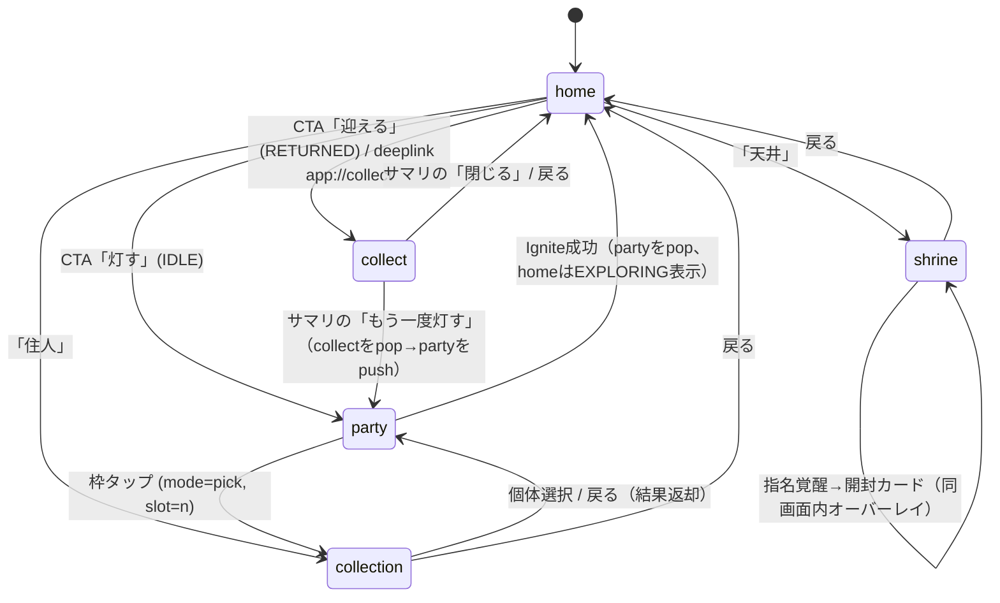

# 設計書05：アプリUI仕様（画面遷移・ナビゲーション規則・ワイヤー）

『遺跡に住みつく精霊』PoC — `:app` / `:feature:*` / `:core:ui` 画面設計（v0.4 叩き台）

改訂履歴：
v0.4 — DEC-07を反映：homeはWidget Large導出を流用し、住人は待機1姿勢、帰還時の✦はコード描画。レアテーマはPoCでは使わない。
v0.3 — 編成画面ヘッダに地域名・天気・曜日祭壇を表示し、タップで**地域選択ダイアログ**（§6.6、ダイアログ6つ目）。修正値プレビューと住人詳細の「今日の相性」を `arrowsFor()`（02 §5.3）の矢印本数＋内訳で確定。性格の説明文を02の性格表に合わせる。画面数は5のまま（設定画面は作らない）。
v0.2 — 住人詳細ダイアログを「住人を見る唯一の場所」に格上げ（§6.7新設）。partyの埋まった枠タップ→詳細、pickモードのタップ→詳細経由で選択に変更。「長押しで外す」を廃止。
v0.1 — 初版。設計書04 §5.1の画面ツリーを、遷移規則・戻る動作・画面ローカル状態・ASCIIワイヤーまで展開。

整合状態：設計書01 v0.5・02 v0.4・03 v0.3・04 v0.3 と相互参照整合済み
前提：見た目は **Material 3（Jetpack Compose）のデフォルト部品＋パレット由来の colorScheme** で担保する。独自デザインする部品は3つに限定（§7）。本書のワイヤーはASCII図で、**配置と要素の有無**だけを確定する（寸法・装飾は確定しない）。

---

## 1. 目的とスコープ

設計書04 §5が「各画面に何があるか」を定義したのに対し、本書は**「画面がどう繋がり、戻るとどうなり、途中で離脱するとどうなるか」**を確定する。AI Agentが実装時に毎回異なる解釈を出しうる箇所（バックスタック、ディープリンク着地、画面ローカル状態）を先に潰すのが目的。

対象外：Widget・通知（04 §3-4）、ログ文言・カード演出の具体（未確定、04 §8）。

---

## 2. ナビゲーション方針（決定事項）

| 項目 | 決定 | 根拠 |
|---|---|---|
| 構造 | **ハブ型**（home起点、放射状）。ボトムナビ不採用 | 画面5枚・主動線は「灯す→待つ→回収」の1本。常設タブは薄いhomeと競合し、Widget中心方針（04 §8）に反する |
| 実装 | 単一Activity＋Navigation Compose。ルートは `home` 1つ、他は全てhomeの上に積む | ディープリンク着地時に「下にhome」を常に保証できる（§4） |
| 戻るの原則 | **戻る＝1段上へ**。例外はcollectの開封中のみ（§3.2） | 迷わせない。タスク途中離脱でデータを失わせない |
| モーダル | 確認・入力は**ダイアログ**（画面遷移しない）。住人詳細・ニックネーム入力・魔力に還す確認・指名覚醒コスト確認・通知権限文脈説明・地域選択（v0.3）の6つ | 画面数を増やさない。天気の地域設定のために設定画面を作らない |
| 選択サブ画面 | party の枠タップは **collection を `mode=pick` で再利用**（新画面を作らない） | 一覧カード・ソートを共有。実装量削減 |
| 住人の閲覧 | **住人をタップしたら必ず住人詳細ダイアログ**（§6.7）。文脈でボタンだけ変わる | 「どこで能力を見るか」を1箇所に固定。ルール1本 |
| 状態表示 | 全画面が `sessionFlow` を購読し `derivePhase()` で描く。**画面はフェーズを保存しない** | 01 原則B。homeに戻った瞬間に正しい表示 |

---

## 3. 画面遷移図

### 3.1 遷移図



### 3.2 戻る動作表

| 画面／状態 | 戻る（システムバック） | 補足 |
|---|---|---|
| home | アプリ終了 | ルート |
| party | home | 編成の変更は**即時保存**（03のparty preset）。破棄確認なし |
| collection（通常） | home | 選択モード中なら**まず選択モード解除**、2回目でhome |
| collection（`mode=pick`） | party（未選択で戻る） | 枠は変更なし |
| collect / LOG_PLAYING | → **SUMMARY** へ | ログスキップ扱い。homeには戻らない |
| collect / OPENING | → **SUMMARY** へ | 「残りをまとめて開ける」と同じ扱い |
| collect / SUMMARY | home | サマリはcollectのゴール。ここからだけ離脱可 |
| shrine | home | 開封カードオーバーレイ表示中は、まずオーバーレイを閉じる |
| ダイアログ表示中 | ダイアログを閉じる（キャンセル） | 全ダイアログ共通 |

**collectの例外の根拠**：`Collect()` のDB書込（ロール確定・住人挿入・魔力加算・レシート）は**collect着地直後に完了**している（01 §5、03 §4.1）。ログ再生と開封は演出であり、途中離脱で取り逃しは発生しない。よって「途中で戻る＝演出を早送りしてサマリへ」が自然で、確認ダイアログも不要。

---

## 4. ディープリンク着地規則

| リンク | 発火元 | 着地手順 |
|---|---|---|
| `app://collect` | Widget／通知のRETURNEDタップ | ① バックスタックを `home` のみにリセット → ② `derivePhase()==RETURNED` を評価 → ③ 成立：`Collect()` 実行後 collect を push／不成立：**何もせずhomeを表示**（Toast・ダイアログなし） |
| `app://home` | Widget（IDLE/EXPLORING）タップ、通知（非RETURNED）タップ、ランチャー | バックスタックを `home` のみにリセット |

- ②③は01 原則Dのガード。古い通知からのタップ・二重タップは「正しい現在表示」で吸収する
- 着地時に既にcollectが開いている（前回の演出途中でバックグラウンド化）場合：レシート済みなので `Collect()` は走らず、**開いていたcollectをそのまま前面に**（状態は§5の画面ローカル状態を `rememberSaveable` で保持）

---

## 5. 画面ローカル状態

状態機械（01）はIDLE/EXPLORING/RETURNEDの3つだが、アプリ画面には**永続化しない**ローカル状態がある。これらは `ViewModel` 内に持ち、プロセス死からの復帰は `SavedStateHandle` で行う。

| 画面 | ローカル状態 | 復帰時の扱い |
|---|---|---|
| collect | `stage ∈ {LOG_PLAYING, OPENING(index), SUMMARY}`、`revealed: Set<Int>` | 復帰。ただしログ再生位置は保持せず、LOG_PLAYINGなら先頭から（数秒の再生なので許容） |
| collection | `sort`、`filter`、`selectionMode: Boolean`、`selected: Set<Long>` | sort/filterのみ復帰。選択は破棄 |
| party | `pickingSlot: Int?` | 復帰不要（collectionから戻れば解決） |
| shrine | `pendingMotifId: Long?`（コスト確認中）、`revealCard: Resident?` | 破棄 |

ローカル状態は**フェーズ変化で自動的に無効化されるものを持たない**設計にする（例：party画面を開いたままEXPLORINGになることは、Ignite自体がparty→homeへpopするので起きない）。

---

## 6. ワイヤーフレーム（ASCII）

凡例：`[ ]` ボタン／`( )` タップ可能領域／`▓` 画像・スプライト／`░` 無効・シルエット。寸法は確定しない。

### 6.1 home（フェーズ別3態）

homeは**薄く**保つ（04 §8の方針を採用）。役割は「今どの状態か」「次に押すものは1つ」「他画面への入口2つ」の3点のみ。

```
IDLE                          EXPLORING                     RETURNED
┌────────────────────┐       ┌────────────────────┐       ┌────────────────────┐
│ 遺跡に住みつく精霊   │       │ 遺跡に住みつく精霊   │       │ 遺跡に住みつく精霊   │
├────────────────────┤       ├────────────────────┤       ├────────────────────┤
│                    │       │                    │       │                    │
│   ▓▓  ▓▓    ▓▓    │       │   ▓▓         ▓▓   │       │   ▓▓  ▓▓ ✦  ▓▓   │
│  ▓▓▓▓ ▓▓ ▓▓ ▓▓▓   │       │  ▓▓▓▓      ▓▓▓   │       │  ▓▓▓▓ ▓▓ ▓▓ ▓▓▓   │
│  ─────遺跡────────  │       │  ─────遺跡────────  │       │  ─────遺跡────────  │
│  (Widgetと同じ導出   │       │  留守番組のみ        │       │  帰宅・コードの✦     │
│   deriveWidgetScene)│       │                    │       │                    │
│                    │       │  🏮 帰還まで 1:23:45 │       │  🏮 精霊が帰ってきた │
│                    │       │  ━━━━━━●━━━━━━━━━  │       │                    │
├────────────────────┤       ├────────────────────┤       ├────────────────────┤
│ [    灯す   →    ] │       │ [░ 探索中… ░░░░░░] │       │ [   迎える   →   ] │
├──────────┬─────────┤       ├──────────┬─────────┤       ├──────────┬─────────┤
│ (住人 12) │ (天井 ◐)│       │ (住人 12) │ (天井 ◐)│       │ (住人 12) │ (天井 ◐)│
└──────────┴─────────┘       └──────────┴─────────┘       └──────────┴─────────┘
```

- 遺跡ビューは `deriveWidgetScene()` を**Largeサイズクラスで流用**（04 §3.2）。home専用の描画ロジックは持たない。縦画面への適合は実装時に確認し、PoCでは専用背景を追加しない（DEC-07）
- EXPLORING中のCTAは無効化し残り時間を表示。**ログ途中経過は見せない**（04 §3.4）
- 下部2ボタンは常に同じ。「住人」に所持数、「天井」にゲージ簡易表示
- 初回起動：初期付与1体（03 §6）の開封カードを**homeの上にオーバーレイで1回だけ**見せてから通常表示（§7の開封カード再利用）

### 6.2 party（編成）

```
┌────────────────────┐
│ ←  編成            │
├────────────────────┤
│ 千葉・☔雨 ／ 木曜   │  ← effectiveWeather()（03 §2.1）。タップで地域選択（§6.6）
│ 植物の祭壇の日       │  ← 曜日祭壇の材質（02 §5.3）
├────────────────────┤
│ ┌──────┐ ┌────┐ ┌────┐
│ │隊長 ★ │ │    │ │    │
│ │ ▓▓▓  │ │ ▓▓ │ │ ＋ │
│ │ ★★★★ │ │★★  │ │    │
│ │ 石・穏 │ │水・雨│ │    │
│ └──────┘ └────┘ └────┘
│  埋まった枠タップ→住人詳細（入れ替える／外す）
│  空の枠タップ→collection(mode=pick, slot=n)
│ ⓘ 隊長は通知に表示されます
├────────────────────┤
│ 修正値プレビュー      │
│  石像 ↑   穏やか      │  ← arrowsFor() の本数＋内訳（02 §5.3、04 §5.3）
│  スライム ↑↑↑ 雨・雨好き│
├────────────────────┤
│ [      灯す      ]  │  ← 前回編成プリセット済み→1タップで点火
└────────────────────┘
```

- 「灯す」押下 → 初回のみ通知権限文脈ダイアログ（04 §4.4）→ `Ignite()` → **partyをpopしてhome（EXPLORING表示）へ**
- 枠が0体でも点火可（トラッカーはランタンにフォールバック、04 §4.1）。ただし空編成時はCTAラベルを「灯す（編成なし）」にして意図を確認する（叩き台）
- **埋まった枠**をタップ→住人詳細ダイアログ（§6.7）。「入れ替える」でpickへ、「外す」で空枠に。**空の枠**をタップ→pickへ直行。長押し操作は持たない
- ヘッダの天気は `effectiveWeather()`（03 §2.1）。画面を開いたときに `refreshIfStale()` を非同期で呼び、取得できたらFlowで静かに差し替わる（スピナーは出さない）。**点火はそのとき表示中の値で固定される**
- 地域未設定のときヘッダは「地域を選ぶ ›」。天気は中立（`UNKNOWN`）で、天気由来の矢印はプレビューに出ない
- 修正値プレビューは編成中の各住人について1行（名前・矢印の本数・内訳ラベル）。鎮めと魔力は記号を分ける（04 §5.3）
- 編成中の住人の能力・性格・今日の相性は、この詳細ダイアログで確認する。party画面の修正値プレビューは**編成全体の合算**、詳細ダイアログは**個体単位**という役割分担

### 6.3 collect（回収：3段階）

```
LOG_PLAYING                   OPENING(index=1/3)            SUMMARY
┌────────────────────┐       ┌────────────────────┐       ┌────────────────────┐
│    探索の記録        │       │   目を覚ました  1/3  │       │   帰還             │
├────────────────────┤       ├────────────────────┤       ├────────────────────┤
│ 第1層に入った。      │       │   ┌────────────┐   │       │ 目を覚ました住人     │
│ 燭台が先を照らす。    │       │   │  ✦ 発光 ✦  │   │       │ ┌───┐┌───┐┌───┐   │
│ 何かが動いた──       │       │   │   ▓▓▓▓▓    │   │       │ │▓▓ ││▓▓ ││▓▓ │   │
│ 鎮めた。            │       │   │  ▓▓▓▓▓▓▓   │   │       │ │★4 ││★2 ││★5 │   │
│ ▌                   │       │   │  ★★★★★     │   │       │ └───┘└───┘└───┘   │
│                    │       │   │  性格：夜行性  │   │       │                    │
│                    │       │   │  色：発光色    │   │       │ 魔力  +120         │
│                    │       │   │ (名前をつける) │   │       │ 天井 ━━━━━━━━●━━  │
│                    │       │   └────────────┘   │       │                    │
│                    │       │                    │       │                    │
│ (タップで全文表示)    │       │ [   次をめくる   ]  │       │ [  もう一度灯す  ]  │
│                    │       │ [残りをまとめて開ける]│       │ [     閉じる     ]  │
└────────────────────┘       └────────────────────┘       └────────────────────┘
        ↓ 末尾到達／タップ2回目          ↓ 全開封                    ↓ 閉じる→home
                                                                 もう一度灯す→party
```

- ログ末尾で自動的にOPENINGへ。1体目のカードは**裏面表示から始め、タップでめくる**
- 開示順：★ → 性格 → 色（04 §5.2）。レア色以上はめくる前にカード裏面の発光で予告
- 「残りをまとめて開ける」は2体目以降に表示（04 §5.2-4）
- 「名前をつける」はカード上の任意導線 → ダイアログ。スキップ可（04 §8の未確定項目：開封直後に**置く**方を叩き台として採用。テンポを損ねるなら外す）
- 全書込は着地時に完了済み。この画面に「保存」「確定」ボタンは**存在しない**

### 6.4 collection（住人一覧：通常／選択／pick）

```
通常                          選択モード                    mode=pick（partyから）
┌────────────────────┐       ┌────────────────────┐       ┌────────────────────┐
│ ←  住人 12   [選択] │       │ ×  3体選択    [還す] │       │ ←  隊長を選ぶ       │
├────────────────────┤       ├────────────────────┤       ├────────────────────┤
│ 新着▼  ★▼  モチーフ▼│       │ 合計 +90 魔力       │       │ 新着▼  ★▼  モチーフ▼│
├────────────────────┤       ├────────────────────┤       ├────────────────────┤
│ ┌───┐┌───┐┌───┐   │       │ ┌───┐┌───┐┌───┐   │       │ ┌───┐┌───┐┌───┐   │
│ │▓▓ ││▓▓ ││▓▓ │   │       │ │▓▓✓││▓▓ ││▓▓✓│   │       │ │▓▓ ││▓▓ ││░░ │   │
│ │★4 ││★2 ││★5 │   │       │ │★2 ││★4🔒││★1 │   │       │ │★4 ││★2 ││★5 │   │
│ │壺  ││しずく││結晶│  │       │ │   ││ 編成中││   │  │       │ │   ││   ││編成中│  │
│ └───┘└───┘└───┘   │       │ └───┘└───┘└───┘   │       │ └───┘└───┘└───┘   │
│ ┌───┐┌───┐┌───┐   │       │ ┌───┐┌───┐┌───┐   │       │ ┌───┐┌───┐┌───┐   │
│ │   ││   ││   │   │       │ │   ││   ││   │   │       │ │   ││   ││   │   │
│ └───┘└───┘└───┘   │       │ └───┘└───┘└───┘   │       │ └───┘└───┘└───┘   │
└────────────────────┘       └────────────────────┘       └────────────────────┘
 カードタップ→住人詳細（§6.7）  🔒 / 編成中 は選択不可          カードタップ→住人詳細（§6.7）
                              （03 §4.4）                    →「この住人を選ぶ」で返却
                                                              編成中の個体はボタン無効
```

- カード＝開封カードの縮小版（★／性格／色が一目、04 §5.4）。**同一Composableのsize引数違い**（§7）
- 「還す」→ 確認ダイアログ「N体を魔力に還します（+90）」→ 実行 → 選択モード解除
- カードタップは全モードで住人詳細ダイアログ（§6.7）。選択モード中のみカードタップ＝選択トグル（詳細は開かない）
- `mode=pick`：詳細ダイアログの「この住人を選ぶ」で返却。既に別枠に入っている個体はボタン無効。1タップ増えるが一覧カードに★・性格・色が出ているため許容（速さが必要なら「長押しで即選択」を後から追加可）。**空にする**ボタンをヘッダ右に置く（叩き台）

### 6.5 shrine（天井：指名覚醒）

```
┌────────────────────┐
│ ←  天井            │
├────────────────────┤
│ 魔力  1,240 / 2,000 │
│ ━━━━━━━━━━━●━━━━━━ │  ← balance実残高。lifetimeEarned は伸びる演出用
├────────────────────┤
│ 発見済み 7 / 10      │
│ ┌───┐┌───┐┌───┐   │
│ │▓▓ ││▓▓ ││░░ │   │  ← 未発見はシルエット、選択不可
│ │壺  ││しずく││ ? │   │
│ └───┘└───┘└───┘   │
│ ┌───┐┌───┐┌───┐   │
│ │▓▓ ││░░ ││▓▓ │   │
│ └───┘└───┘└───┘   │
└────────────────────┘
 タップ→確認ダイアログ「壺を目覚めさせる（−2,000）」
   →namedAwaken→開封カードをオーバーレイ表示（collectと同じ部品）
   →閉じるとshrineに戻る（ゲージ減少を反映）
```

- 残高不足のモチーフはタップ可・ダイアログで不足額を表示（叩き台。グレーアウトよりも「あと760」が動機になる）

### 6.6 ダイアログ一覧

| ダイアログ | 発火 | ボタン | 備考 |
|---|---|---|---|
| 通知権限の文脈説明 | 初回「灯す」直前 | 「知らせてもらう」／「今はしない」 | 後者でもIgniteは実行（通知は前提ではない、04 §4.3） |
| ニックネーム入力 | 開封カード／詳細ダイアログ | 保存／スキップ | 空で保存＝解除。表示は `nickname ?: モチーフ名` |
| 魔力に還す確認 | collection選択モード「還す」 | 「還す」／キャンセル | 合計魔力を再表示。破壊的操作なので**確認ボタンは左寄せしない**（M3既定） |
| 指名覚醒確認 | shrineモチーフタップ | 「目覚めさせる」／キャンセル | 残高不足時は実行不可＋不足額表示 |
| 住人詳細 | collectionカード／partyの埋まった枠／pickモードのカード | 文脈別（§6.7） | 住人の能力を見る唯一の場所 |
| 地域選択（v0.3） | partyヘッダのタップ | 都道府県を選ぶ（単一選択リスト）／閉じる | 地方ごとの見出し付きで47都道府県。選ぶと即時に天気を取得（03 §2.1）。**下部に「出典：気象庁ホームページ」を常時表示**。初回起動では出さない（初回点火時の通知権限ダイアログと重ねない） |

### 6.7 住人詳細ダイアログ（住人を見る唯一の場所）

```
┌────────────────────┐
│   ▓▓▓▓  つぼ丸 ✎   │  ← nickname ?: モチーフ名。✎で入力ダイアログ
│   ★★★★  レア色     │
│   壺 ／ 土器 ／ M級  │  ← 器・材質・サイズクラス（＝属性相性・ロール）
│   性格：雨好き       │
│   「雨や雪の日、鎮め │  ← 性格の効果説明（02 §5.3の説明文）。性格表が
│    がうまくいきやすい」│     そのまま攻略の説明を兼ねる（コアループ §5）
│   今日の相性 ↑↑↑    │  ← arrowsFor() の個体分（本数）
│    雨・雨好き        │  ← 内訳ラベル（Arrows.sources）
│   🔒 保護  [  ○]    │  ← locked切替（世界観上の呼称は未確定）
├────────────────────┤
│  文脈で変わるボタン   │
└────────────────────┘
```

| 開いた場所 | ボタン | 備考 |
|---|---|---|
| collection（通常） | 閉じる | ニックネーム・保護の編集はここで |
| collection（`mode=pick`） | **「この住人を選ぶ」**／閉じる | 別枠で編成中なら選ぶボタン無効＋「編成中」表示 |
| party（埋まった枠） | **「入れ替える」**（→pick）／**「外す」**／閉じる | 隊長枠なら「入れ替える」のラベルを「隊長を替える」に |

- 表示内容は全文脈で同一。変わるのは下部ボタンのみ（`ResidentDetailDialog(resident, actions)` の1 Composable）
- 中央のカード部は `ResidentCard(size=L)` を再利用（§7）
- 「今日の相性」は `arrowsFor()`（02 §5.3）の個体分で、partyの修正値プレビューと同じ値
  - party（埋まった枠）から開いたとき：実際の編成・枠位置で計算（先導役の効果も含む）
  - collection／pickから開いたとき：その個体を**隊長以外の枠に単独で入れた場合**として計算（他の住人に依存する効果は出さない）。先導役の個体には「隊長にすると仲間全員 ↑」と説明文だけ添える

---

## 7. 見た目の方針

**独自に作る部品は3つだけ。それ以外はMaterial 3のデフォルト。**

| 部品 | 用途 | 仕様 |
|---|---|---|
| `ResidentCard(size)` | 開封カード（L）／一覧カード（S）／隊長枠（M） | スプライト＋★＋性格＋色バッジ＋ニックネーム。レア色・発光色で背景・枕縁が変わる。**裏面**状態を持つ（開封用） |
| `ManaGauge` | home下部（簡易）／shrine（フル）／サマリ（伸び演出） | `balance` を実値、`lifetimeEarned` をアニメ用に受ける |
| `RuinsScene` | home上部 | `deriveWidgetScene()` の出力をComposeで描く。Widget側（Glance）と描画コードは別だが**入力は同じ** |

- **colorScheme**：`00_共通_パレット定義` のスウォッチから `dynamicColor=false` の固定スキームを生成。精霊質色を `primary`、遺跡の石色系を `surface` に割当（叩き台）
- **ダークテーマを既定**（遺跡・夜・ランタンの世界観。ライトはOS追従で用意するが調整優先度は低）
- タイポグラフィはM3既定。ログ再生のみ等幅または明朝系を検討（未確定、文言トーンと同時に決める）
- アニメーション：カードめくり（`graphicsLayer` の rotationY）とゲージ伸長の2つのみ。他はM3標準のトランジション

---

## 8. 検証方法

- **ナビゲーション**：Navigation Compose の `TestNavHostController` で§3.2の戻る動作表を表駆動テスト
- **ディープリンク**：`adb shell am start -d app://collect` を IDLE／EXPLORING／RETURNED／レシート済み の4状態で実行し、着地画面をスクリーンショット比較（04 §7の自走ループに統合）
- **画面ローカル状態**：collectをOPENING途中でプロセスキル → 復帰でOPENINGに戻ることを `adb shell am kill` で確認
- **天気**：`WeatherSource` をフェイクに差し替え、未設定／取得成功／取得失敗（前回値が6時間以内）／取得失敗（6時間超）の4状態で party ヘッダとプレビューをスクリーンショット比較
- **デモ定数E2E**：home→party→灯す→（3分）→collect→サマリ→もう一度灯す、を1本のadbスクリプトで通す（04 §7を本書の遷移で具体化）

---

## 9. 未確定事項（叩き台として置いたもの）

- 空編成での点火を許すか（許す場合のCTAラベル）
- ニックネーム導線を開封直後に置くか（テンポ検証後に判断。04 §8と共通）
- 隊長枠の詳細ダイアログにトラッカーアイコンのプレビュー（「通知にこう出ます」）を置くか
- pickモードに「長押しで即選択」のショートカットを足すか（詳細経由の1タップ増が気になった場合）
- collection `mode=pick` の「空にする」配置
- shrineの残高不足モチーフをタップ可にするか
- ログ再生の書体

---

## 付記：他設計書との接点

| 設計書 | 接点 |
|---|---|
| 01 状態機械 | §3.2 collect例外の根拠（Collect書込タイミング）、§4 原則Dガードの着地時評価 |
| 02 ロールエンジン | §6.3 LOG_PLAYING の `LogEvent` 消費、namedAwaken の開封カード再利用、§6.2・§6.7 の矢印は `arrowsFor()`（02 §5.3） |
| 03 データ層 | §6.4 locked・編成中の選択不可、party preset即時保存、初期付与のhomeオーバーレイ、§6.2ヘッダ・§6.6地域選択は `WeatherRepository`（03 §2.1） |
| 04 プレゼンテーション層 | §5.1の画面ツリーを本書§3が実装定義。§7 `RuinsScene` は04 §3.2の導出関数を共有 |
