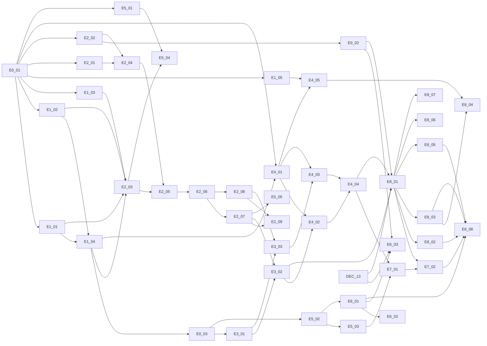

# planning/ — タスク分解と起票

`issues/` は起票前の一時原本、`create_issues.py` は一括起票スクリプト。現在は GitHub issue への移行が完了しており、GitHub 側が正。対応表は `issue_map.json`。

| 種別 | ラベル | 担当 | 件数 |
|---|---|---|---|
| 実装 | `type:impl` | エージェント | 43（E0〜E8） |
| 決定 | `type:decision` | 人間（人間だけが閉じる） | 13（DEC-01〜13） |
| 実機検証 | `type:verify` | 人間 | 6（VER-01〜06） |

---

## 1. GitHub への移行状況

- リポジトリ：`SakumaTakuya/additive-game`（Private）。プロジェクト名は `additive-game`、アプリ名は `Seirei Ruins`
- CODEOWNERS の所有者は `@SakumaTakuya`
- Epic 9件と issue 62件を起票済み。ID 対応は `issue_map.json` に保存
- 起票後に `issues/` 原本は削除済み。issue 本文がタスクの正
- GitHub Free の Private リポジトリではブランチ保護を設定できない。公開範囲を変えずに必須チェックと Code Owner レビューを強制するには、Private リポジトリ対応プランが必要

## 2. 決定 issue の扱い

DEC にはすべて推奨と暫定値が書いてある。実装はその暫定値で先に進み、コードに `TODO(DEC-xx)` を残す。
**着手前に決めておきたいのは DEC-13 だけ**（E6-03・E8-01 がこれを待つ）。数値系（DEC-01〜05）はデモで遊んでから決めるのが早い。

## 3. 依存関係



図のノード名は `E0_01` ＝ E0-01。正確な依存は各 issue の「依存」欄が正（この図は読みやすさのために一部省略）。

## 4. 並行して走らせるとき

- **同じモジュールに2つのエージェントを入れない**。ブランチ（または git worktree）をモジュール単位で分ける
- E0-01 が閉じた直後に並行できる系列：`:core:model`（E1）／`:core:roll` の土台（E2-01・E2-02）／`:core:database`（E4-01 は E1-04 待ち）／テーマ（E5-01）
- 純 Kotlin 層（E1〜E3）は CI だけで検証が閉じるので、最初に一気に進めやすい
- Android 依存層（E4 以降）は PR にスクリーンショットが要る（ADR D-004）

## 5. エージェントへの渡し方

Codex・Cursor はどちらもリポジトリの `AGENTS.md` を読む。渡すのは issue だけでよい。

```
issue #<番号> を実装してください。AGENTS.md の「作業の進め方」に従い、
受け入れ条件をテストとして先に書き、./gradlew check を通してから PR を作ってください。
```

エージェントが GitHub に触れられない環境なら、issue 本文をそのまま貼る。
仕様を追加で伝えたくなったら、口頭（チャット）で言わずに**issue を書き換えてから**新しいセッションで渡し直す。

## 6. 新しい Epic を足すとき

`issues/` に原本を書き（見出しの形式は既存ファイルと同じ）、`create_issues.py` の `FILES` に足して `--dry-run` → 起票。起票済みの ID は `issue_map.json` で飛ばされる。
